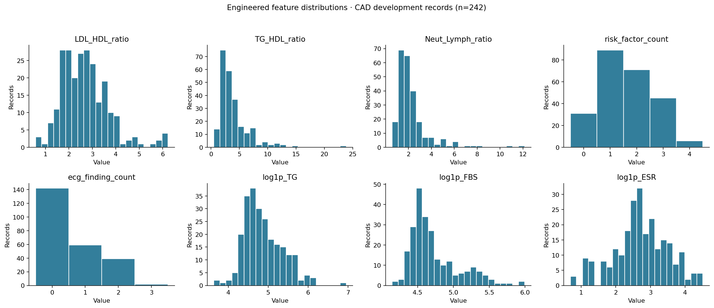

# Dataset and feature analysis



*Exploratory feature distributions; see the notebook for partition details and
the limits of this analysis.*

`dataset.csv` is the original 303-record, 59-column clinical table. The feature
pipeline reads this source; generated columns are calculated inside preprocessing
rather than appended to the training CSV.

## Files

| Path | Purpose |
|---|---|
| `dataset.csv` | Original measurements and four diagnosis labels |
| [columns.metadata.md](columns.metadata.md) | Raw-column types, recorded units, categories and descriptive ranges |
| [statistical-analysis-of-cad-dataset.ipynb](statistical-analysis-of-cad-dataset.ipynb) | Earlier general statistical notebook; includes its original data-loading assumptions |
| [engineered-feature-analysis.ipynb](engineered-feature-analysis.ipynb) | Executed analysis of eight proposed derived features |
| `engineered_features_analysis.py` | Reproducible helpers for that exploratory experiment |
| `engineered_feature_analysis/` | Derived values, tables, plots, predictions and provenance |

## Input and target separation

The targets are `Cath` (CAD/Normal), `LAD`, `LCX` and `RCA` (Stenotic/Normal).
All four are excluded from every model's predictors. Dropping constant
`Exertional CP` leaves 54 raw inputs. Patient identifiers are not provided, and
measurement timing is undocumented.

Derived features use only those inputs: LDL/HDL, TG/HDL, Neut/Lymph, two binary
finding counts and `log1p` TG/FBS/ESR. The full definitions and production defaults
are documented in [feature engineering](../docs/feature-engineering.md).

## What the engineered-feature notebook evaluates

- Formula correctness, invalid operands and target exclusion.
- Distributions, log-transform skewness and redundancy with original measurements.
- Positive/negative group differences for all four targets, with exploratory
  Mann–Whitney tests and adjustment across 32 comparisons.
- Six fixed feature sets using the existing target-specific model settings.
- Three repeats of five-fold CV per target: 360 fits and 17,424 OOF predictions.

Each target retains the original seed-42 stratified 80/20 split. Its 242 development
rows are used for target associations and model comparisons; its 61 historical
holdout rows are excluded. Distribution/correlation plots use the CAD development
partition. Partitions differ between targets.

The notebook originally compares log loss and other metrics. Accuracy discussed
later is calculated from the saved OOF predictions at threshold 0.5; it can rank
feature sets differently. [Metric comparison](../docs/evaluation.md#engineered-feature-comparison).
The defaults chosen from these results are exploratory, not independent validation
of a feature-selection procedure.

## Outputs and reproduction

`engineered_feature_analysis/engineered_features.csv` contains eight derived
columns for all 303 source rows, indexed by zero-based `row_index`. It contains
no labels. It is a deterministic research export, not a training replacement.
The split manifests identify which rows participate in each target's analysis.

Other outputs include feature definitions/summary statistics, correlation and
association tables, seven PNG plots, fold and complete-repeat metrics, paired
changes, individual OOF predictions, `findings.txt`, and `provenance.json` with
source/data hashes and dependency versions.

To execute the notebook from the repository root, install the pinned training
dependencies and a Jupyter environment providing IPython, nbformat, nbconvert
and a Python kernel, then run:

```bash
MPLCONFIGDIR=/tmp/cardisoft-mpl-cache OPENBLAS_NUM_THREADS=1 OMP_NUM_THREADS=1 python3 -m nbconvert --to notebook --execute --inplace dataset/engineered-feature-analysis.ipynb --ExecutePreprocessor.timeout=1800
```

Rerunning overwrites the analysis outputs in this folder. The executed notebook
and original helper preserve the exploratory experiment. Active training and
inference share `training/preprocessing.py`; regression tests compare its formulas
with the saved analysis export. Integrating features does not by itself retrain
serving models or update their historical holdout scores.
