# Dataset

File: `dataset/dataset.csv` — extension of the Z-Alizadeh Sani CAD dataset
(UCI). **303 rows × 59 columns, zero missing values.** Companion notes:
`dataset/columns.metadata.md` (raw-column dictionary),
`dataset/statistical-analysis-of-cad-dataset.ipynb` (statistical analysis) and
`dataset/engineered-feature-analysis.ipynb` (executed feature experiment).
`dataset/README.md` is the file/reproduction guide. The root `analysis.ipynb`
is early EDA and does not define the current training pipeline.

## Column groups (59 total)

- **Targets (4, leakage — never inputs)**: `LAD, LCX, RCA, Cath`.
- **Dropped (1)**: `Exertional CP` — zero variance (all `N`).
- **Inputs (54)**: 33 numeric/binary + 21 categorical (see
  [preprocessing](preprocessing.md)).

| Category | Count | Columns |
|---|---:|---|
| Demographic | 5 | Age, Weight, Length, Sex, BMI |
| History | 12 | DM, HTN, Current Smoker, EX-Smoker, FH, Obesity, CRF, CVA, Airway disease, Thyroid Disease, CHF, DLP |
| Exam | 7 | BP, PR, Edema, Weak Peripheral Pulse, Lung rales, Systolic/Diastolic Murmur |
| Symptoms | 7 | Typical Chest Pain, Dyspnea, Function Class, Atypical, Nonanginal, Exertional CP (dropped), LowTH Ang |
| ECG | 7 | Q Wave, St Elevation, St Depression, Tinversion, LVH, Poor R Progression, BBB |
| Labs | 14 | FBS, CR, TG, LDL, HDL, BUN, ESR, HB, K, Na, WBC, Lymph, Neut, PLT |
| Echo | 3 | EF-TTE, Region RWMA, VHD |

## Engineered features and analysis files

The source CSV remains 59 columns. Engineered features are calculated from its
54 allowed inputs by `training/preprocessing.py`; generated columns are not
added to the CSV or accepted as API fields. Ratios and counts are added to
model inputs, while the log set replaces TG, FBS and ESR with their `log1p`
values. See [Feature engineering](feature-engineering.md) for formulas.

The notebook exports plots, descriptive/association tables, complete-repeat
CV metrics, out-of-fold probabilities and a deterministic derived-feature
CSV under `dataset/engineered_feature_analysis/`. Its exploration helper
`dataset/engineered_features_analysis.py` preserves the experiment; active
training and serving share the production transformer instead. Target
comparisons use only the appropriate 242-row development partition. The
[evaluation page](evaluation.md#engineered-feature-comparison) separates these
results from the historical serving metrics.

## Target balance

| Target | Positive | Negative | Note |
|---|---|---|---|
| Cath (CAD) | 216 (71.3%) | 87 | imbalanced → stratified split mandatory |
| LAD | 177 (58.4%) | 126 | mild imbalance |
| LCX | 119 (39.3%) | 184 | minority positive |
| RCA | 114 (37.6%) | 189 | minority positive |

The 71.3% CAD prevalence means a naive "always predict CAD" classifier achieves
71.3% accuracy. Stratified splits preserve this ratio in train/test partitions.
`class_weight="balanced"` (or `scale_pos_weight` for XGBoost) counteracts the
imbalance during training.

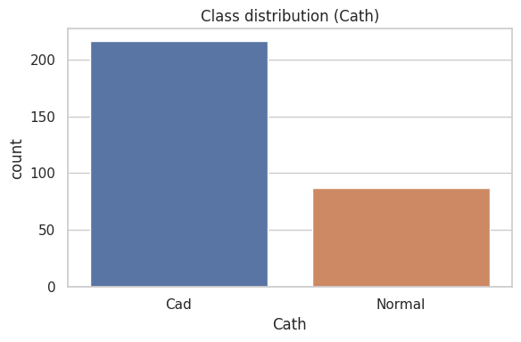

*Cath label counts from the statistical analysis notebook. This is the full
303-record cohort; model selection and evaluation use the documented
development and held-out splits.*

## Exploratory notebook gallery

The figures below come from `dataset/statistical-analysis-of-cad-dataset.ipynb`.
That notebook explores the full 303-record cohort, including records used by
later train/test evaluations. Its analyses are descriptive and must not be read
as independent validation. Some later plots use the notebook's experimental
outlier-capped copy of the data; that capping is not part of the production
preprocessing pipeline. The newer feature-set experiment and its development
partition are described in [Feature engineering](feature-engineering.md) and
[Evaluation](evaluation.md).

### Numeric distributions and outlier review

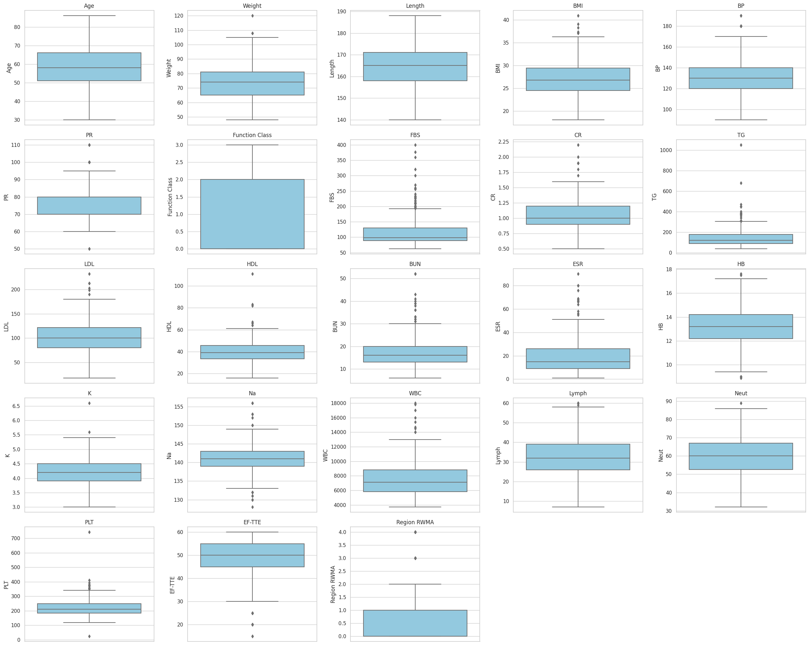

*Raw cohort distributions from the statistical notebook. The boxplots are a
visual review of spread and extreme values, not rules for removing records.*

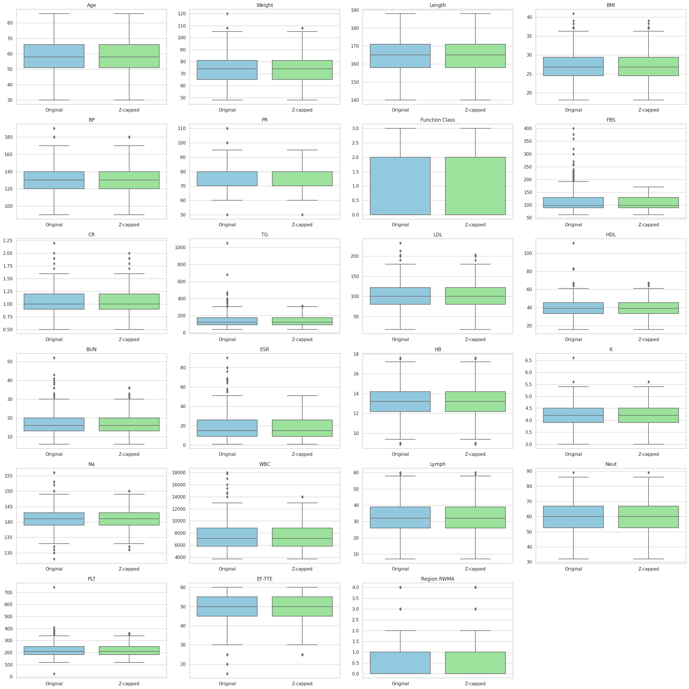

*The notebook compared original values with a modified-z-score capping
experiment to preserve rows. This transformed copy was for exploration; the
deployed preprocessing does not winsorize these measurements.*

### Relationships among features and labels

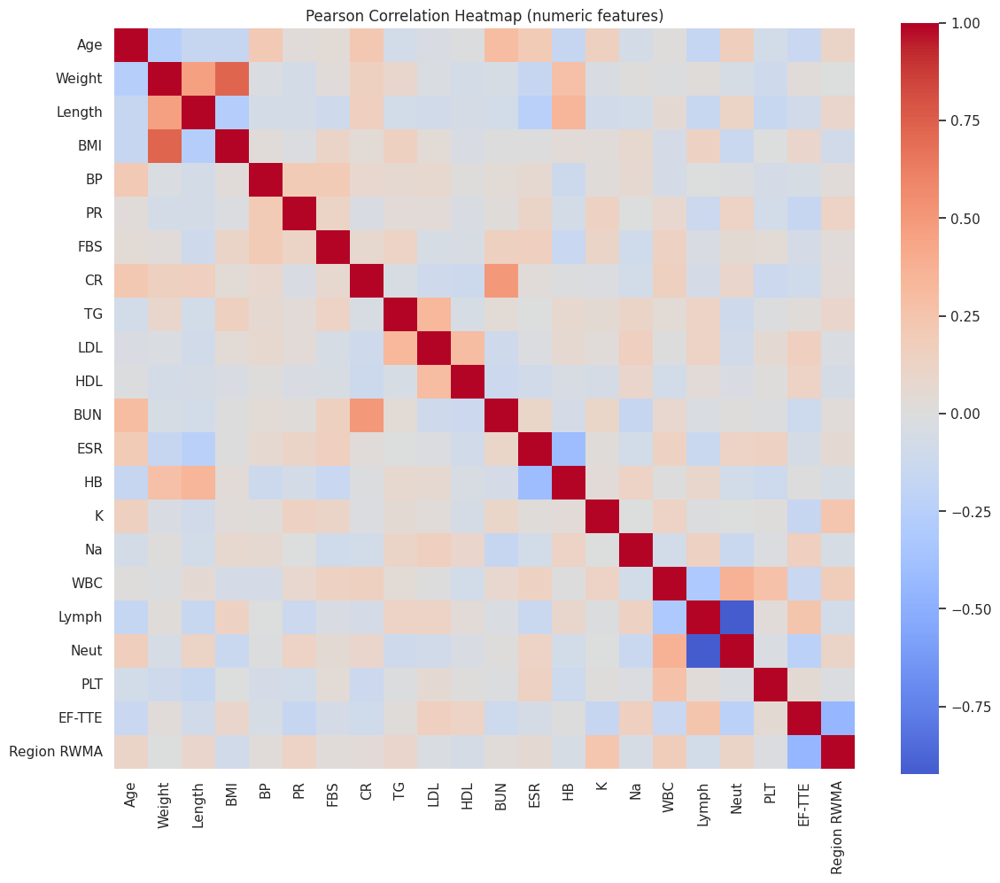

*Both heatmaps show associations among numerical columns. The largest
relationship is between Lymph and Neut (Spearman ρ ≈ −0.91); Weight and BMI
also move together (ρ ≈ 0.72). These patterns help identify redundancy for
feature review.*

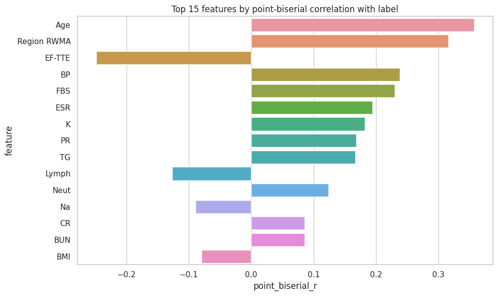

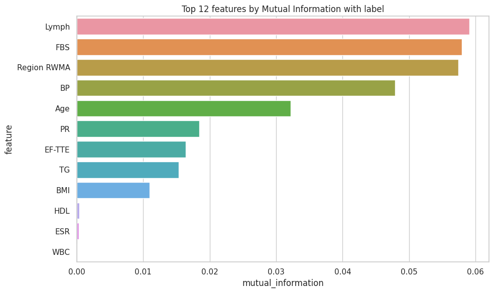

*The notebook's univariate summaries put Age, Region RWMA, EF-TTE, BP and FBS
among the larger point-biserial associations; its mutual-information ranking
also highlights Lymph, FBS and Region RWMA. These are marginal associations
from the full cohort, not causal effects or model feature-importance scores.*

### PCA and LDA projections

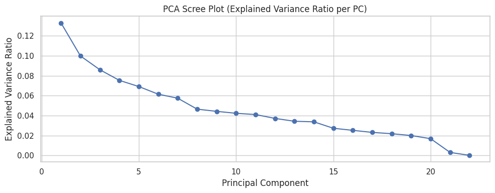

*The first five components explain about 46% of variance in the notebook's
standardized numerical feature matrix. PCA summarizes variation; it does not
optimize for the CAD label.*

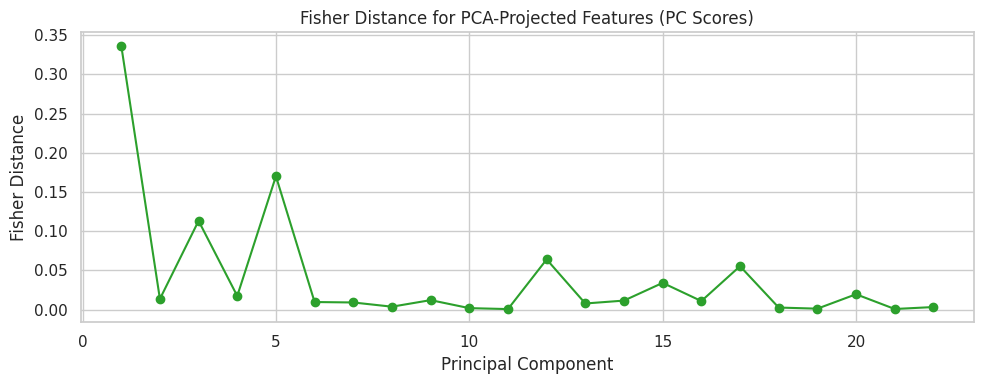

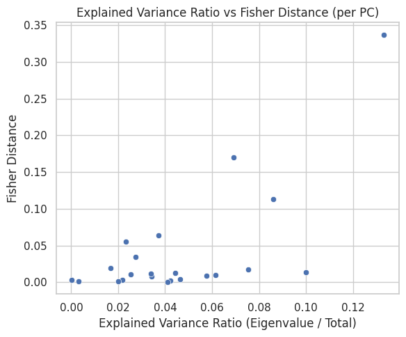

*The notebook compared variance captured with class separation. Their
Spearman association was 0.462: high-variance directions were not consistently
the most class-separating directions.*

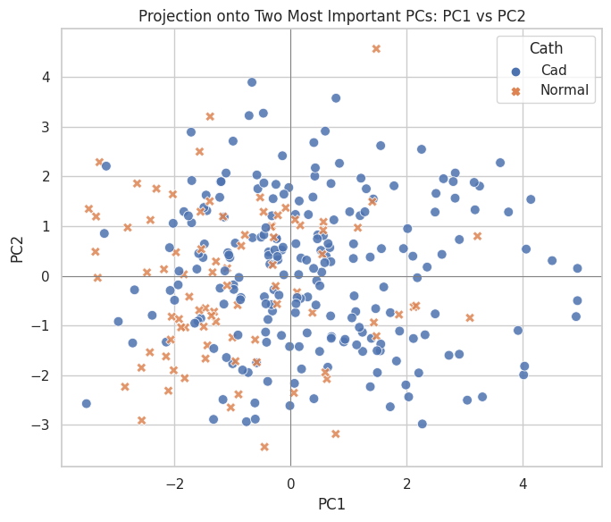

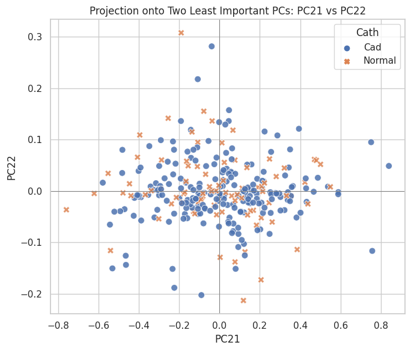

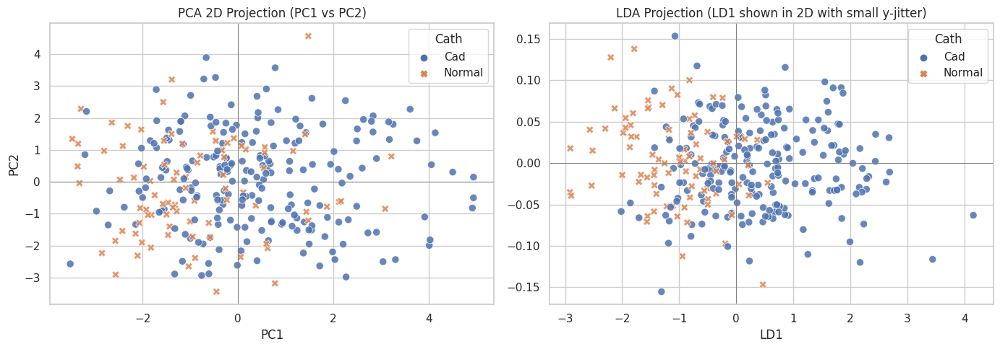

*The PCA plot shows overlap between labels in two dimensions. LDA is a
supervised one-dimensional projection; the vertical jitter is only for display
and does not represent a second LDA coordinate. These projections are
exploratory visualizations, not a deployed prediction model.*

### Clustering experiments

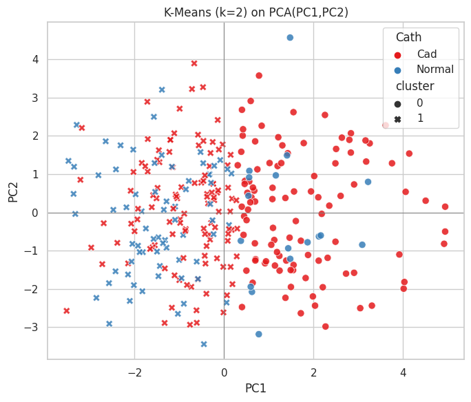

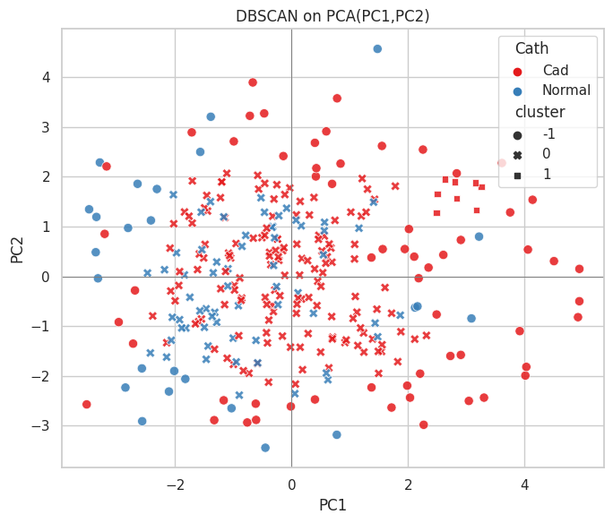

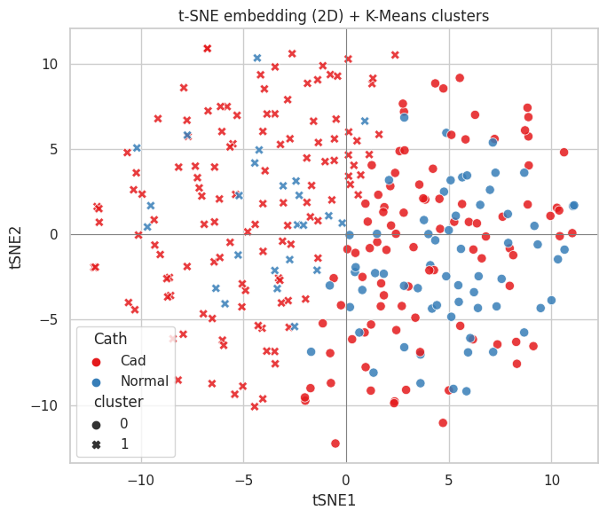

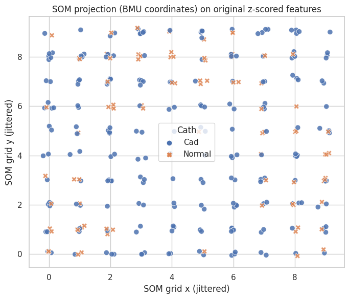

*The notebook's K-means and t-SNE cluster assignments have little agreement
with Cath (ARI 0.007 and 0.049; NMI 0.055 and 0.056). DBSCAN also has near-zero
agreement (ARI −0.016; NMI 0.014) and marks 85 records as noise. These
unsupervised experiments do not recover reliable CAD classes; the plotted
embeddings are sensitive to preprocessing and algorithm settings.*

## Label structure (measured, motivates chains — see IMPROVEMENTS.md)

- P(CAD | vessel stenotic): LAD 0.994, LCX 1.0, RCA 1.0 — CAD is nearly a
  deterministic OR of the three vessel labels
- P(vessel | CAD): LAD 0.815, LCX 0.551, RCA 0.528
- Co-occurrence: LCX→LAD 81%, RCA→LAD 76%, LAD→LCX 54% / RCA 49%

This structure means CAD prediction can benefit from vessel-signal improvements,
and vessel models could theoretically use each other's predictions as features
(classifier chains — backlogged in IMPROVEMENTS.md §3).

## Known quirks (handled in `clean_dataframe()` / documented, not silently fixed)

- `Sex`: typo `Fmale` (127 rows) → normalized to `Female`
- `Region RWMA`: int codes 0–4, mapping undocumented → treated as categorical
- Near-constant: `CHF` (1 positive), `LowTH Ang` (2) — kept with regularization
- Rare Y-levels (n<12): CRF, CVA, Weak Peripheral Pulse, Diastolic Murmur, Poor
  R Progression, Lung rales, Airway disease — unstable under CV, kept faithfully
- Outlier review list (never blind-dropped): TG 1050, FBS 400, BP 190, PR 110,
  WBC 18000, PLT 25/742, HDL 111, BUN 52
- Collinear pairs: Neut/Lymph (differentials), Weight/Length/BMI/Obesity

## Importance ratings

Column metadata (`dataset/columns.metadata.md`) assigns importance based on domain prior + observed stats:

| Importance | Count | Examples |
|---|---|---|
| High | 10 | DM, HTN, Typical Chest Pain, St Depression, Tinversion, EF-TTE, Region RWMA, VHD |
| Medium-High | 9 | Age, DLP, FBS, LDL, HDL, Dyspnea, Atypical, Q Wave, LVH |
| Medium | 10 | Weight, FH, BP, PR, Systolic Murmur, Nonanginal, BBB, CR |
| Low-Medium | 16 | EX-Smoker, Obesity, Edema, Weak Peripheral Pulse, Lung rales, Diastolic Murmur, BUN, ESR, HB, K, WBC, Lymph, Neut, PLT |
| Low / Sparse | 9 | CRF, CVA, Airway disease, Thyroid Disease, CHF, Poor R Progression, LowTH Ang, Na |

Importance is a modeling prior, not a causal claim. High-importance features
are expected to dominate model predictions but are not guaranteed to be the
strongest predictors in every model.

## Data dictionary

Full per-column metadata (types, ranges, means, modes, descriptions) is in
`dataset/columns.metadata.md`. Each column documents:
- Type and value range observed in the dataset
- Clinical description
- Suggested preprocessing considerations (the implemented policy is documented
  in [Preprocessing](preprocessing.md))
- Importance rating
- Known issues (outliers, sparsity, collinearity)
