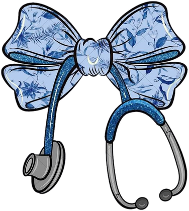

Cardisoft

Heart risk, explained

<h1>Cardisoft docs</h1>

Technical documentation for the cardiovascular risk visualization &amp; prediction
system (Multimodal AI Hackathon 2026 — Track A).

303 patients
4 prediction heads
Test AUC 0.893 (CAD)
Engineered features supported

New training runs use CAD logs, LAD counts, LCX ratios/counts and RCA baseline
features. The checked-in serving models still use baseline inputs; their test
scores below have not been regenerated with engineered features. Start with
[feature engineering](feature-engineering.md) for the implementation and
[evaluation](evaluation.md) for the evidence.

Want to see the application before the technical details? Take the
[product tour](showcase.md) for screenshots, a sample workflow, and API calls.

-   **Problem Formulation**

    What are we predicting, and what must the system never claim? Four binary targets,
    hard constraints (leakage, no lesion localization), and current scope status.

    [Start here](problem-formulation.md)

-   **Dataset**

    What's in `dataset/dataset.csv`? 303 rows × 59 columns, zero missing values.
    Column groups, target balance, label structure, and known data quirks.

    [Inspect the data](dataset.md)

-   **Preprocessing**

    How 54 raw inputs become model features: row-wise engineering, fold-fitted
    imputation, scaling and categorical encoding. Output widths depend on the
    selected feature set and preprocessing track.

    [See the pipeline](preprocessing.md)

-   **Feature Engineering**

    Implemented ratios, counts and log transforms, target-specific defaults,
    missing-value rules, exploratory accuracy results and serving compatibility.

    [Read the feature guide](feature-engineering.md)

-   **Multimodal Input & Fusion**

    Speech transcription, report OCR, and PDF text import flow into reviewed
    structured fields. See how these inputs relate to model-level fusion.

    [See the design](multimodal-fusion.md)

-   **Models**

    Seven model families (RF, XGB, HGB, LGBM, CatBoost, Stacking, Voting), 32 configurations
    per target, 10×5-fold repeated CV selection. Current winners: CatBoost for CAD,
    Random Forest for vessels.

    [Compare models](models.md)

-   **Evaluation**

    Held-out test metrics on 61 patients per target, confusion matrices, and
    accuracy measured with the submitted fields available. Calculation steps,
    uncertainty intervals, calibration status and external validation gaps.

    [Read the results](evaluation.md)

-   **CAD Nested Validation**

    Isolated CAD experiments with inner model/calibration selection and paired
    outer evaluation. Feature sets are fixed before each run.

    [Run an experiment](cad-nested-validation.md)

-   **Explainability**

    Patient-specific grouped permutation Shapley values: algorithm walkthrough,
    additivity contract, interpretation guidelines, and limitations.

    [Understand explanations](explainability.md)

-   **Visualization**

    Implemented React dashboard and interactive schematic 3D heart. Coronary surface
    registration, camera presets, vessel selection, and the API surface consumed
    by the frontend.

    [See the contract](visualization.md)

-   **API**

    FastAPI endpoints (`/health`, `/predict`, `/explain`, `/model-info`,
    `/input-defaults`), assessment accuracy context, request/response schemas,
    validation rules, error codes, and curl examples.

    [Use the API](api.md)

-   **Engineering Decisions**

    Architecture decision records (ADRs): why separate training/serving, four
    independent models, three preprocessing tracks, reproducible artifacts, and more.

    [Read the ADRs](engineering-decisions.md)

Related: `../PROBLEM.md` (challenge spec), `../training/README.md`,
`../backend/README.md`, `../training/IMPROVEMENTS.md` (model backlog).
