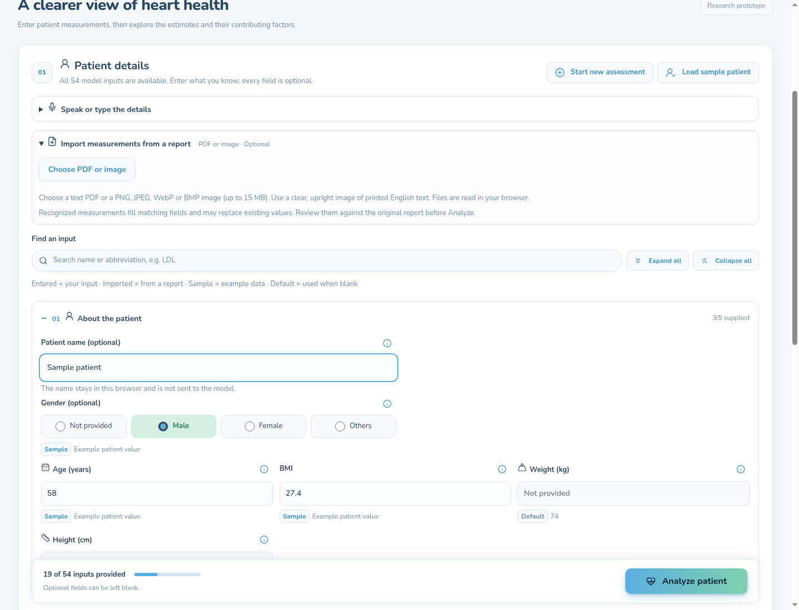
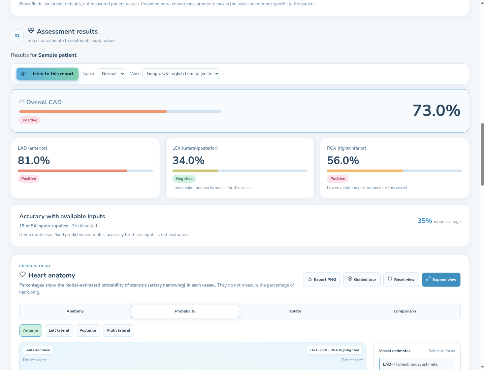
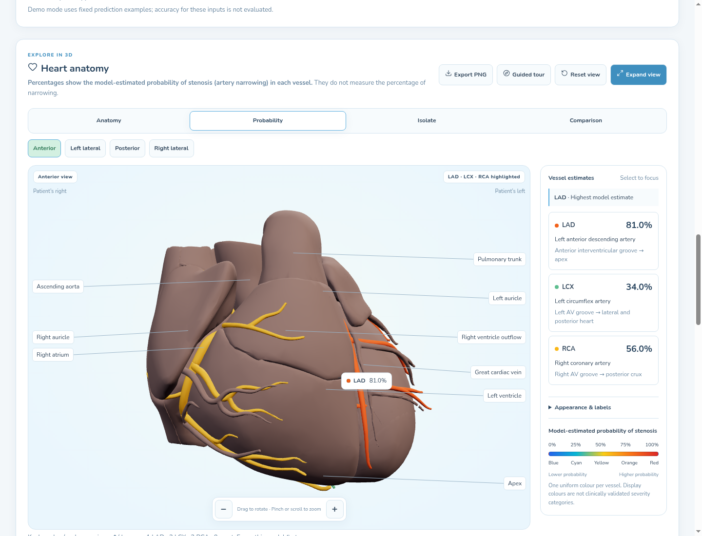

# Product tour

<div class="cardisoft-brand cardisoft-brand-tour" aria-label="Cardisoft — Heart risk, explained">

<div class="cardisoft-brand-copy">
<div class="cardisoft-brand-word">Cardi<span>soft</span></div>
<div class="cardisoft-brand-tag">Heart risk, explained</div>

</div>
</div>

Cardisoft brings a 54-field assessment form, a FastAPI prediction service,
patient-specific explanations, report import, and a schematic 3D heart into one
workflow. This page walks through the interface and shows how to call the API.

!!! warning "Research prototype"
    The screenshots below were captured from the explicitly labeled offline
    demo. Its predictions and explanations are fixed examples and do not change
    when inputs change. Live mode uses the configured backend. Neither mode is
    a medical diagnosis or a substitute for clinical assessment.

## 1. Review the assessment inputs

The form groups the 54 optional raw inputs by topic. Search helps locate a field;
section controls expand or collapse groups. A status badge distinguishes
entered, imported, sample, and default values. Blank fields are allowed and the
server applies documented defaults when an analysis is submitted.


*Assessment form with sample values loaded. The sticky footer shows the number
of supplied fields. A patient name stays in the browser and is not sent to the
prediction model.*

For the current 54-field contract, aliases, categories, and validation limits,
see the [API reference](api.md#post-predict) and `frontend/src/fields.ts`.

## 2. Import a report for review

The report panel accepts selectable-text PDFs and supported report images. PDF
text extraction uses pdf.js; image OCR uses Tesseract.js in the browser. The
importer maps recognized values to a subset of form fields. It does not parse
every report or automatically fill all 54 inputs.



*The screenshot shows the uploader before a file is selected. After import,
recognized values appear in matching form fields for review. The file and
recognized text are not sent to the prediction API; only measurements are sent
after the user selects Analyze patient.*

See `frontend/README.md` for supported formats, size limits, cancellation
behavior, and sample fixtures.

## 2a. Speak or type measurements

The assessment also accepts a spoken or typed description, such as “age 58,
blood pressure 140, diabetes yes.” Speech recognition uses the browser's
speech service; in Chrome, audio is processed online, so use demo data only.
Cardisoft parses the transcript into candidate fields for review. Nothing is
applied until the user confirms, and the form should be checked before analysis.

This is another way to enter structured fields. The audio or transcript is not
sent to the Cardisoft prediction API; the reviewed field values are sent only
after Analyze patient is selected.

## 3. Inspect estimates and context

The result view summarizes the CAD estimate and three vessel estimates. It also
shows input coverage and, in live mode when validation resources are available,
held-out cohort accuracy for the exact set of fields supplied.



*The percentages shown here are fixed demo values. In live mode, model output
depends on the submitted input. Input coverage measures how many raw fields
were supplied; it is not confidence. The accuracy panel evaluates historical
records using the same supplied/defaulted field pattern, not the individual
patient's correctness.*

Selecting an estimate opens its explanation. Contributions are approximate,
grouped permutation Shapley values in probability units. They describe how the
model responds to inputs; they do not describe medical causes. Read the
[explainability guide](explainability.md) for the method and additivity
relationship.

## 4. Explore the schematic anatomy

The 3D view lets users rotate the heart, change orientation, isolate or compare
the LAD, LCX, and RCA, and inspect vessel labels. Vessel color and percentages
show model-estimated probability, not measured narrowing or lesion location.



*The anatomy is a schematic orientation aid, not patient imaging. The sample
percentages in this demo screenshot are fixed fixtures.*

## API example

The frontend submits only the raw measurements the user supplied. This example
asks for predictions with two inputs; omitted fields are completed with API
defaults. Run the backend locally as described in the root `README.md` before
trying it:

```bash
curl -X POST http://127.0.0.1:8000/predict \
  -H 'Content-Type: application/json' \
  -d '{"Age":66,"Typical Chest Pain":1}'
```

The response includes four estimates plus context. A shortened example:

```json
{
  "cad": {"prediction": 1, "probability": 0.73},
  "vessels": {
    "LAD": {"prediction": 1, "probability": 0.81},
    "LCX": {"prediction": 0, "probability": 0.34},
    "RCA": {"prediction": 1, "probability": 0.56}
  },
  "context": {
    "input_validation": {
      "supplied_count": 2,
      "total_features": 54,
      "status": "available",
      "method": "held_out_default_substitution"
    }
  }
}
```

This is an abbreviated response shape; the live API returns additional context,
including all defaulted fields, model fingerprints, and per-target evaluation
details. The numbers are illustrative and do not represent a real patient.
For the full schema, validation errors, and explanation response, see the
[API documentation](api.md).

## Example explanation request

```bash
curl -X POST http://127.0.0.1:8000/explain \
  -H 'Content-Type: application/json' \
  -d '{"target":"cad","features":{"Age":66,"Typical Chest Pain":1},"top_k":10}'
```

The explanation response includes a baseline probability, signed contributions
for the selected raw fields, a residual, and model identity. Within numeric
precision:

```text
base_value + sum(feature contributions) + remaining_contribution = probability
```

## More project details

- [System scope and limits](problem-formulation.md)
- [Dataset and label structure](dataset.md)
- [Feature engineering](feature-engineering.md)
- [Model evaluation](evaluation.md)
- [Technical API reference](api-reference/backend.md)
- Local setup and deployment: `README.md`
