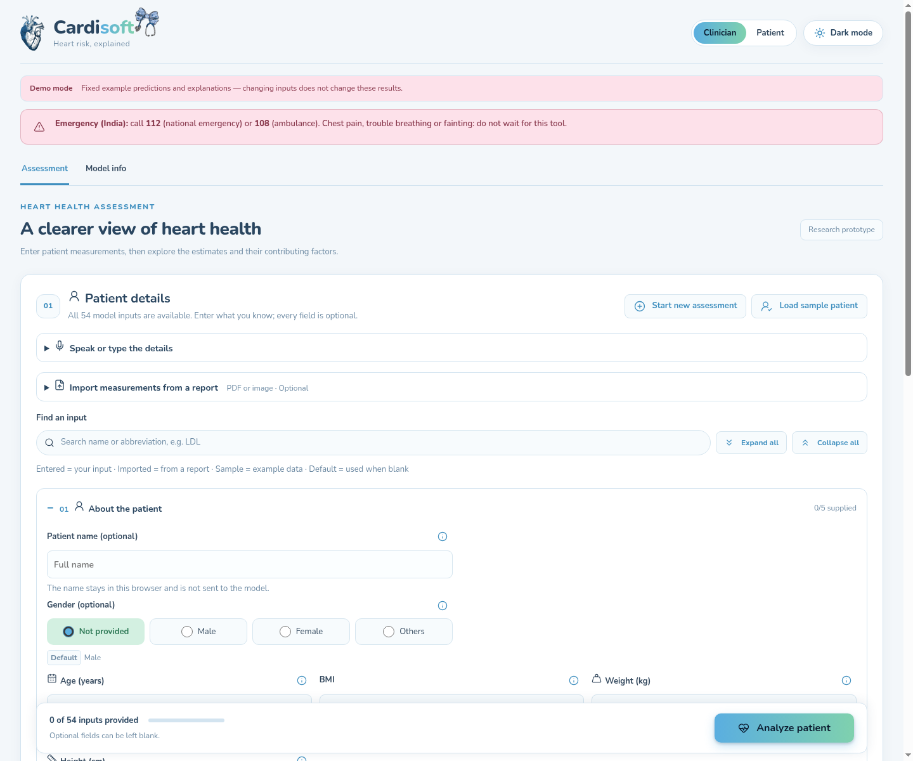

# Frontend — Cardisoft dashboard



React + TypeScript + Vite, Recharts, and React Three Fiber. The dashboard
collects patient measurements, imports text PDFs and report images, requests four predictions,
and links the selected vessel to its explanation and schematic 3D heart.
Clinician and patient views use different presentation language.

## Run

Start the backend on port 8000 (see the [root README](../README.md)), then run
from the repository root:

```bash
cd frontend
npm ci
npm run dev
```

| Setting | Default | Meaning |
|---|---|---|
| `VITE_USE_MOCK` | false | Only the literal `true` enables fixed offline fixtures |
| `VITE_API_URL` | /api | API base; Vite proxies this prefix to localhost:8000 during development |

See `.env.example`. Restart Vite after environment changes. A mode banner is
always visible; demo mode says its outputs do not respond to changed inputs.
Failed live requests show errors, never substitute fixtures. Production hosting
must proxy `/api` to FastAPI or configure an API origin at build time; `vite
preview` has no development proxy.

## Engineered features and model updates

The form and API continue to accept 54 raw measurements. Ratios, counts and log
transforms are calculated by each saved backend preprocessor; they are not extra
form fields or report-import targets. Input coverage still counts supplied raw
fields out of 54. API defaults are applied before feature engineering, and the
explanation service attributes engineered models to their raw inputs.

New training defaults are CAD `logs`, LAD `counts`, LCX `ratios_counts` and RCA
`baseline`. The checked-in serving models and offline metadata snapshot still
describe baseline models. After retraining, evaluate the saved artifacts, export
`frontend/public/model-info.json`, and restart the backend as described in the
[training guide](../training/README.md). Live metadata comes from `/model-info`;
new artifacts expose `feature_set` and `engineered_features` there. Older
metadata omits those fields.

## Data and display

`src/fields.ts` defines all 54 raw clinical inputs, grouped into eight sections. Every
field is optional; blank numeric inputs and “Not provided” selections are
omitted from requests and receive explicit server defaults. No/absent is an
explicit choice, distinct from missing. Supplied values must pass numeric or
category validation. Names are not included in requests. Category selections
are translated to the backend's exact values. Units appear beside measurements;
acceptance limits are not diagnoses.

Each input has an info button that opens a brief explanation and a Google search
link in a new tab. Searches use fixed topic names from `src/fieldInfo.ts`, never
patient values. Escape or clicking outside closes the explanation. Model-specific
function-class and wall-motion codes are described without inventing clinical
scale mappings.

The form starts with About the patient expanded. Section headers show supplied
counts and invalid-field counts; Expand/Collapse all controls and a field search
help navigate all inputs. Search matches names, abbreviations and help topics
and opens matching sections without changing values. Invalid values display
inline messages; Analyze clears the search, opens affected sections and focuses
the first invalid input. Empty fields remain valid and optional.

Field badges distinguish Entered, Imported, Sample and Default values. Editing
an imported value changes its badge to Entered; clearing it shows the actual
server default again. Badges describe input source, not clinical reliability.

Results lead with the overall CAD estimate, followed by vessel estimates,
an accuracy panel, anatomy, explanations, and report/comparison tools. Mobile
users can jump between Inputs, Results and Anatomy using the sticky navigation.
Prediction, explanation, heart loading, report import and report preparation each
have separate status text.

Start new assessment clears patient inputs, provenance, imported-file details,
results, explanations and comparison state, while retaining theme/view preferences.
Late prediction/import responses are ignored after reset, and leaving/resetting
an assessment cancels its pending report download.

### Report import

For ready-to-use PNGs, see [dummy report fixtures](public/sample-reports/README.md)
or download [the sample ZIP](public/sample-reports/dummy-report-pngs.zip). The set
includes complete, partial, invalid-value, unmatched-text and blank-image cases
with exact expected results.

In either view, open **Import measurements from a report**, choose a file, and
review the filled measurements before **Analyze patient**. Matching values
replace existing values and receive an Imported badge; unmatched fields remain
unchanged. Importing does not submit an assessment automatically.

- Text PDFs: pdf.js extracts selectable text, up to 20 pages/200,000 characters.
- PNG, JPG/JPEG, WebP and BMP: Tesseract.js reads printed English text locally.
- Files are limited to 15 MB. Images above 40 megapixels are rejected; others
  are scaled to at most 3,500 pixels on the longest edge for OCR.
- Progress appears during recognition. **Cancel import** or **Start new assessment**
  prevents late results from filling fields. The OCR worker is terminated when
  recognition finishes or is cancelled; if it is still loading, it is terminated
  when loading completes. A two-minute timeout ends a stalled OCR request.

`import/report.ts` validates and routes files; `import/imageText.ts` manages image
decoding and OCR. `pdf/extractText.ts` handles PDF text, and both paths use the
existing `pdf/fieldMap.ts` aliases and negation heuristics. The mapper recognises
the original 19 measurement/history fields, not arbitrary report contents or
every one of the 54 form inputs. Out-of-range matches are skipped, not clamped.
Imported Sex updates the model input and visible Male/Female selection; a
preselected Others identity remains selected.

Use clear, upright images. Handwriting, blurry photos, complex tables and
unrecognised units can produce missing or incorrect matches. No unit conversion
or clinical interpretation is performed. Verify the values against the original.
For image-only PDFs, save pages as supported images and import them individually.
HEIC, TIFF and animated GIF are not supported; convert them to PNG/JPEG first.

Files and recognised text remain in the browser. The normal prediction request
sends the resulting measurements only when Analyze is selected. `ocrAssets.ts`
serves the worker, WebAssembly cores and English data from the app itself and
includes them under `dist/ocr/` during production builds. Deploy that directory
alongside the app; no OCR API key or external OCR service is needed. The engine
loads only when an image is selected and caches language data in IndexedDB.
See the [Tesseract.js API](https://github.com/naptha/tesseract.js/blob/master/docs/api.md).

### Prediction and explanation

`api.ts` calls `/predict`, `/explain`, `/input-defaults`, and `/model-info`. Live explanations use
signed, approximate patient-specific Shapley contributions, grouped by original
feature. The chart shows the largest eight contributions, including defaulted
features marked default; the detailed table distinguishes provided values from
server defaults for all 54 inputs.
Errors appear in both clinician and patient views.

`ModelInfo.tsx` uses live saved-artifact metadata. Offline demo mode uses
`public/model-info.json`, an explicitly labelled saved-evaluation snapshot:

```bash
# From repository root, after training and evaluation:
python training/model_info.py --output frontend/public/model-info.json
```

`public/mock_predict.json` and `public/mock_explain.json` remain illustrative
fixtures for explicit demo mode. The obsolete mock metrics file has been removed.

## Verification and limits

The input coverage panel counts supplied and defaulted fields and lists the
server defaults. Coverage measures completeness, not prediction confidence.
Demo mode reads the matching `public/input-defaults.json` fixture.

The **Accuracy with available inputs** panel beside the results uses
`context.input_validation` from the completed assessment. It shows measured
held-out accuracy for the same supplied/missing field pattern, correct counts,
95% intervals, recall, full-input accuracy and an always-guess baseline for all
four targets. Which fields were supplied matters, not just their number.
Coverage is displayed separately and is never converted into an accuracy score.
Zero supplied fields show a default-only warning. Form edits leave the previous
scores in place with a reanalysis notice. Demo mode, older backends and missing
validation resources display an unavailable message, without fabricated scores.
The PDF export includes the same assessment-specific validation results.

For an Age-and-Diabetes submission, the backend keeps those columns on each
target's held-out test records and substitutes defaults for the other 52. It
compares the frozen model's classifications with the known labels. The displayed
percentage is `100 * correct / n_test` (currently 61 records per target).
It does not compare this patient's prediction with a known diagnosis.

Changing values while retaining the same field set can change probabilities
without changing test accuracy. Adding or removing fields triggers a different
validation check after **Analyze patient**; a higher input count does not
guarantee a higher score. See the [evaluation method](../docs/evaluation.md#accuracy-with-available-inputs).

After analyzing, choose **Use as comparison baseline**, change inputs, and
analyze again. The comparison shows all four estimates, percentage-point
changes, and changed input values or sources. The baseline stays in browser
memory across dashboard navigation; reloading clears it.

**Download PDF report** exports the completed assessment, including all 54
input values and their sources, predictions, input-dependent test accuracy and
intervals, model fingerprints, available explanations, and the active comparison.
Unsubmitted form edits are excluded.
It also embeds a PNG of the current 3D heart view on a dedicated page, including
visible labels and the estimate legend. The image is captured at the export
click, before explanation requests; wait for the heart to load before exporting.
Missing or mismatched-model explanations are explicitly identified. Demo
reports are labelled as fixed examples. Reports are generated locally using
jsPDF; explanation requests send measurements to the configured API.

```bash
npm run build
npm run lint
npm test
```

Manual check: live mode → sample patient → Analyze → edit values → Analyze
again → verify changed probabilities → select all vessels → check signed
explanations → open Model Info. Import a report with the opposite sex and check
both the displayed selection and submitted value. Repeat on mobile/dark mode.

Import checks: upload the same clear report as PNG and JPEG; verify numeric
measurements, negative findings, Imported badges and untouched fields. Repeat
with a text PDF. Check blank/corrupt/unsupported files, cancel recognition, and
reset while OCR is loading; neither cancellation nor errors should change fields.
`npm test` covers file validation, field mapping and OCR lifecycle/error handling.

Accuracy check: analyze an empty form and verify the defaults-only warning;
supply Age and an explicit `DM=0`, analyze, and verify two supplied inputs and
four test-accuracy cards. Edit a field and confirm the prior scores remain with
a reanalysis notice. Verify the unavailable message with an older backend or
missing validation dataset, and the separate demo-mode message with mock mode.
The regular backend must be restarted to load changes to the validation service.

## Coronary visualization

The viewer retains `public/heart.glb` (Pigcraft, CC BY 4.0), its existing
orientation and large-vessel openings. The registered coordinate frame is
+X patient left, +Y superior, +Z anterior. LAD follows an illustrative anterior
interventricular course; LCX and RCA wrap around the left/right AV grooves.
LAD and LCX meet at a shared left-main origin. RCA has a separate origin.

The asset contains generic mesh chunks, not verified vessel segmentation.
Its small branches cannot be reliably identified from those chunks. Diagonal,
septal, obtuse marginal and distal dominant branches are therefore not invented.
Coronary dominance is unknown, and the RCA is not assumed to supply the PDA.
Branch reconstruction would require an anatomically reviewed, separately
identified coronary tree with an appropriate license. This reference heart is
not a patient scan or a clinically validated reconstruction. Course references:
[normal coronary anatomy](https://pmc.ncbi.nlm.nih.gov/articles/PMC4919754/) and
[coronary variants and dominance](https://pmc.ncbi.nlm.nih.gov/articles/PMC11242126/).

`registration.ts` projects 161 samples per artery onto the actual heart surface
and smooths small surface irregularities within a radius-constrained envelope.
The rendered tubes taper smoothly from proximal to distal, independently of all
predictions. The left main and right origin meet the corresponding tube radii.
Materials have nonmetallic myocardial shading, soft fill and directional lights.
Original colours preserves the asset's texture; Vessel focus uses muted tissue.

Run `npm run anatomy:register` after changing landmarks or the asset;
`npm run anatomy:check` verifies fingerprints, shared origins, continuity,
reference directions and surface contact. It validates registration consistency,
not clinical anatomical accuracy.

### Probability integrity

`viewer/probability.ts` is the shared colour scale for routes, labels, comparison
bars, popup diagrams and image exports. Blue, cyan, yellow, orange and red anchors
at 0%, 25%, 50%, 75%, 100% interpolate continuously in sRGB. They are visualization
ranges, not validated severity categories. Each vessel has one unlit uniform
colour so lighting cannot create apparent spatial probability hotspots.
The left main remains neutral because it has no separate model estimate.

Missing, nonfinite and out-of-range probabilities are unavailable, never zero.
The highest-estimate indicator uses unrounded values, includes exact ties, and
identifies incomplete comparisons. New prediction props update numbers, colours
and comparisons without rebuilding geometry or resetting the camera.

There are no localized stenosis markers, plaque examples, narrowed lumens,
blood-flow animations or inferred segment probabilities. The popup displays a
reference route and a whole-vessel estimate. Optional `vessel_findings` supplied
independently of the prediction are retained as labelled text with their source;
they do not alter geometry or create spatial markers. The current backend does
not supply these measurements.

### Controls and performance

- **Anatomy** restores the opaque textured heart with overlays hidden.
- **Probability** shows all three reference vessels and estimates.
- **Isolate** emphasizes the selected artery while dimming the other two.
- **Comparison** shows all estimates on a common 0–100% bar scale, the highest
  estimate (including ties), and an animated LAD → LCX → RCA tour. Play/Pause,
  Previous and Next work without opening popups or moving keyboard focus.
  Each step lasts 5.5 seconds; manual navigation pauses playback. Hidden tabs
  and offscreen viewers suspend automatic steps.

Select arteries through their 3D paths, anchored labels, comparison cards or
reference table. Cards focus the appropriate anterior or lateral view. Smooth
orbital transitions travel around the heart, including between opposite views.
Reduced-motion preferences disable camera animation. Dragging interrupts a
transition; zoom buttons and pinch/scroll remain available.

Appearance & labels contains the original display, opacity, highlight, isolation
and anatomy-label controls, plus the probability colour toggle. Turning probability
colours off uses a neutral reference colour while keeping numeric predictions.
The legend includes percentage ticks and readable text in both themes.

The five-step guided anatomy tour, expanded view with keyboard focus containment,
Escape dismissal, and PNG/report capture remain available. Guided-tour completion
restores the prior display and camera preset. Popup cards follow projected vessel
labels, docking below narrow canvases or when their anchor rotates out of sight.
No second WebGL context is created for the popup's SVG projection.

The 3D module loads lazily when results need it, keeping Three.js out of the initial
form bundle. Rendering uses demand frames and capped pixel density. Geometry is memoized and
disposed on unmount. Label visibility uses conservative surface-facing culling
instead of repeated raycasts against the million-triangle mesh. DOM callouts and
screen-space leaders are updated only on rendered frames. Anatomy landmark
projection remains a one-time operation when those labels are enabled.

PNG captures include visible labels and their leaders, the camera/display mode,
all numeric estimates, the same five-colour scale, interpretation notes and asset
credit. The footer accommodates narrow mobile widths. WebGL is captured
synchronously without keeping a permanent drawing buffer.

Validation: `npm test`, `npm run anatomy:check`, `npm run build`, `npm run lint`.
Browser checks should cover each mode and artery, ties and unavailable values,
live probability updates, play/pause/previous/next, all camera presets, direct
path picking, both themes, mobile layout, keyboard dismissal and exported PNGs.
